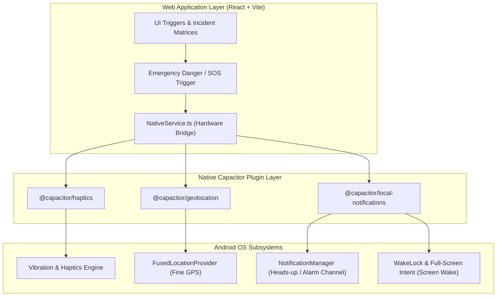

# 📱 DOAB / Z+ Sentinel — Android Native Wrapper & APK Architecture Guide

This document details the architecture, build pipeline, live update workflow, and native device capabilities (SOS, Haptics, Geolocation, Notifications) for the mobile `.apk` wrapper.

---

## 🏛️ 1. Architecture Overview

The mobile app wraps the React (Vite + TypeScript) web application inside a native Android container using **Capacitor** and Android's native `WebViewAssetLoader`.



---

## 🔄 2. Bundled Mode vs. Live Web URL Mode

You have two ways to run the mobile app:

### Mode A: Bundled Mode (Default — 100% Offline-Ready)
* **How it works:** Your React production build (`dist/`) is packaged directly inside the `.apk` file (`app/src/main/assets/public/`).
* **Benefits:** 
  * Zero hosting or domain required.
  * Launches instantly with zero network latency.
  * Guaranteed to work even if presentation venue Wi-Fi drops.
* **Update workflow:** Whenever you change React code, run:
  ```bash
  npm run apk:sync
  ```
  and rebuild the APK (`npm run apk:build`).

### Mode B: Live Web URL / Hot-Reload Mode (Zero Rebuilds Needed)
* **How it works:** The APK directly loads your live hosted web URL (e.g. Vercel) or your local machine IP (`http://192.168.x.x:5173`).
* **Benefits:** 
  * **No rebuilding needed!** Any code changes, UI tweaks, or bug fixes appear on your phone immediately on refresh or via Vite Hot Module Replacement (HMR).
  * Still retains 100% access to native Android SOS, GPS, and Haptic hardware.
* **How to enable:**
  Open [`capacitor.config.ts`](file:///c:/Users/krish/OneDrive/Desktop/%28All_&_Everything%29/%28All-Hackathons%29/WeMakeDevs/Codebase/capacitor.config.ts) and add the `server.url` property:
  ```typescript
  import type { CapacitorConfig } from '@capacitor/cli';

  const config: CapacitorConfig = {
    appId: 'com.zplus.app',
    appName: 'Z+ Sentinel',
    webDir: 'dist',
    server: {
      // 🌐 Point to your live deployed site or local dev server:
      url: 'https://your-live-deployment.vercel.app', 
      cleartext: true
    }
  };

  export default config;
  ```
  Then sync once:
  ```bash
  npx cap sync android
  ```

---

## 🚨 3. Native SOS & Device Hardware Integration

Hardware capabilities are encapsulated in [`src/utils/nativeService.ts`](file:///c:/Users/krish/OneDrive/Desktop/%28All_&_Everything%29/%28All-Hackathons%29/WeMakeDevs/Codebase/src/utils/nativeService.ts):

| Hardware Capability | Plugin / Native API | Trigger in App |
| :--- | :--- | :--- |
| **Emergency Haptics / Vibration** | `@capacitor/haptics` (`Haptics.vibrate`) | `NativeService.triggerSosHaptics()` — Fires emergency vibration pulses when danger broadcast is active. |
| **Emergency Heads-up Alerts** | `@capacitor/local-notifications` | `NativeService.sendEmergencyNotification(title, body)` — Dispatches high-priority system alerts with alert sound and alarm category. |
| **High-Precision GPS** | `@capacitor/geolocation` | `NativeService.getCurrentPosition()` — Queries native Android GPS hardware with high accuracy enabled. |
| **Screen Wake / Interrupt** | Android `WAKE_LOCK` & `USE_FULL_SCREEN_INTENT` | Configured in `AndroidManifest.xml` to allow critical broadcasts to wake device. |

---

## 🛠️ 4. Build Commands & Scripts

In `Codebase/package.json`, the following scripts are configured:

```bash
# 1. Sync React web build into Android project assets
npm run apk:sync

# 2. Build the web app, sync assets, and compile the native debug APK
npm run apk:build

# 3. Open the native Android project in Android Studio
npm run apk:open
```

---

## 📦 5. APK Locations & Installation

* **Deliverables Folder (Primary):**
  [`Deliverables/Z_Plus_Sentinel_Debug.apk`](file:///c:/Users/krish/OneDrive/Desktop/%28All_&_Everything%29/%28All-Hackathons%29/WeMakeDevs/Deliverables/Z_Plus_Sentinel_Debug.apk)
* **Android Gradle Build Output:**
  [`Codebase/android/app/build/outputs/apk/debug/app-debug.apk`](file:///c:/Users/krish/OneDrive/Desktop/%28All_&_Everything%29/%28All-Hackathons%29/WeMakeDevs/Codebase/android/app/build/outputs/apk/debug/app-debug.apk)

### Installing on Device:
1. **Via ADB (USB or WiFi debugging):**
   ```powershell
   adb install -r "c:\Users\krish\OneDrive\Desktop\(All_&_Everything)\(All-Hackathons)\WeMakeDevs\Deliverables\Z_Plus_Sentinel_Debug.apk"
   ```
2. **Via Sideload:** Copy `Z_Plus_Sentinel_Debug.apk` to an Android phone via Google Drive, WhatsApp, or direct USB transfer and tap to install.
