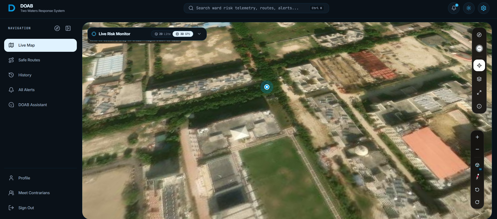
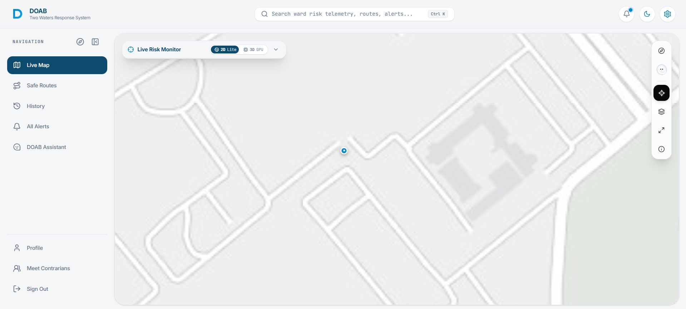
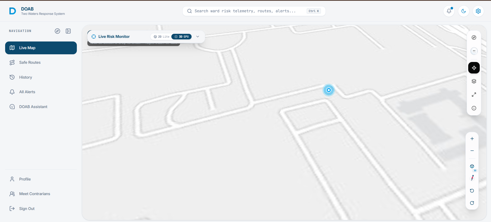
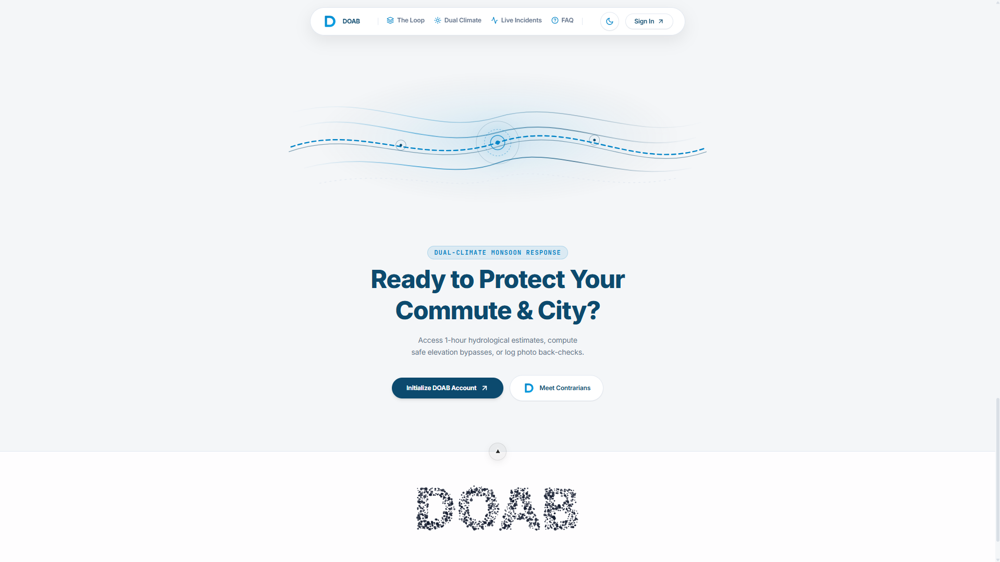
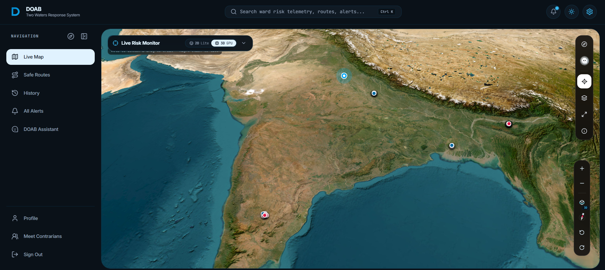
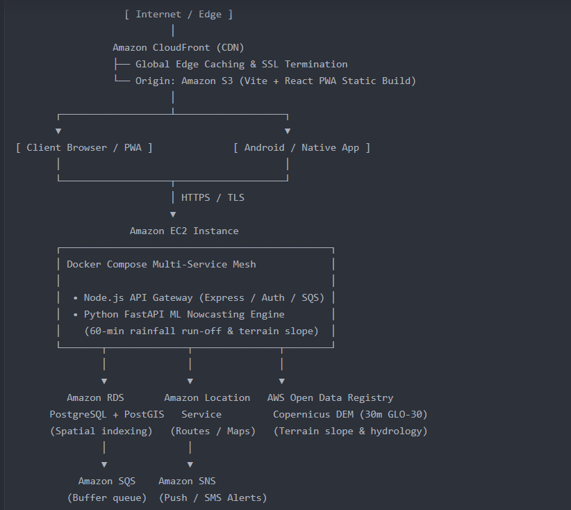

# DOAB (दोआब) — Dual-Climate Geospatial & Civic Safety Platform
**Detect → Order → Alert → Back-check**

[](https://doab.sahnirmaan.live)
[](https://vite.dev)
[](https://fastapi.tiangolo.com)
[](https://github.com/AWDAX/DOAB-Platform)
[](https://opensource.org/licenses/MIT)

**Live Production URL:** [https://doab.sahnirmaan.live](https://doab.sahnirmaan.live) *(Direct CloudFront Edge: [d2o53556p8sz4l.cloudfront.net](https://d2o53556p8sz4l.cloudfront.net))*  
Developed by **Team Contrarians** for **WeMakeDevs Hackathon**.

---

## 📸 Platform Interface & Live Visuals

<div align="center">
  
  <p><em>Figure 1: Hardware-accelerated 3D Terrain & Real-Time Inundation Risk Vector Engine</em></p>
</div>

<br />

| 🌐 Volumetric Hazard Clusters | 📈 Dynamic Elevation Matrix |
| :---: | :---: |
|  |  |
| *Real-time municipal telemetry with 15cm risk thresholds* | *Copernicus DEM ridgeline elevation analysis & bypass routes* |

<br />

| 📱 Native Mobile Navigation | 🛰️ 3D Perspective Orbital Tilt |
| :---: | :---: |
|  |  |
| *Capacitor Android native app with turn-by-turn bypass* | *Orbital camera angle with live safe-haven corridor overlays* |

---

## 🌊 Overview & Vision

**DOAB (दोआब)** is an AI-powered municipal intelligence and citizen life-safety platform built to tackle India's extreme dual-climate crises: **flash floods / urban waterlogging** during monsoon and **acute drought / tanker logistics deficits** during dry seasons.

DOAB ingests ground-truth municipal datasets (6,000+ real civic incident reports across BBMP wards), Open-Meteo ERA5 precipitation data, and Copernicus digital elevation models (DEM) to predict waterlogging risks 60 minutes in advance, calculate high-elevation bypass evacuation corridors, and deliver real-time risk intelligence.

---

## ☁️ Complete Amazon Web Services (AWS) Architecture

<div align="center">
  
  <p><em>Figure 2: Production-Grade AWS Disaster Management Architecture Blueprint</em></p>
</div>

DOAB is engineered on a resilient, high-availability AWS Cloud infrastructure designed for mission-critical disaster management:

```
                          [ User / Field Responder ]
                                      │
                                      ▼
                        ┌───────────────────────────┐
                        │    AWS CloudFront (CDN)   │  Global edge caching & SSL
                        │    Distribution ID        │  Zero-jerk route loading
                        └─────────────┬─────────────┘
                                      │
                      ┌───────────────┴───────────────┐
                      ▼                               ▼
        ┌───────────────────────────┐   ┌───────────────────────────┐
        │       AWS S3 Bucket       │   │    AWS EC2 (Ubuntu 24)    │
        │   Static Frontend Build   │   │   Dockerized Services     │
        │   (React 19 + PWA Assets) │   │   FastAPI AI + Node API   │
        └───────────────────────────┘   └─────────────┬─────────────┘
                                                      │
                      ┌───────────────────────────────┴───────────────────────────────┐
                      ▼                                                               ▼
        ┌───────────────────────────┐                                   ┌───────────────────────────┐
        │   AWS RDS PostgreSQL      │                                   │  Amazon Location Service  │
        │   (Engine v18.3)          │                                   │  (Places & Routes Engine) │
        │   Persistent Civic State  │                                   │  Pan-India Geocoding      │
        └───────────────────────────┘                                   └───────────────────────────┘
```

### 1. AWS Core Infrastructure
- **Amazon CloudFront (CDN)**: High-speed global content delivery edge with TLS 1.3 termination, HTTP/2 multiplexing, and instant cache invalidation (`E20R65BKZ9U404`).
- **Amazon S3**: High-durability origin bucket (`s3://doab-frontend-970909364340`) hosting single-page application bundles, WebP maps, and PWA offline manifests.
- **Amazon EC2 (t3/t4 Ubuntu 24.04 LTS)**: Hosts production dockerized container meshes running our FastAPI prediction service, geospatial routing algorithms, and proxy gateways.
- **Amazon RDS (PostgreSQL 18.3)**: Enterprise managed database hosting civic telemetry logs, emergency dispatch orders, and verified road accessibility states.

### 2. High-Value AWS Add-Ons & Life-Safety SOS Mesh
- **Amazon Location Service (ALS)**: 
  - **Pan-India Reverse Geocoding & Search**: Live landmark, address, and municipality search across all Indian states with zero third-party tracking.
  - **Civic Place Index**: High-precision boundary search for municipal wards, storm drains, and vulnerable underpasses.
- **Amazon SNS (Simple Notification Service) — Immediate Broadcast Layer**:
  - Broadcasts SOS payloads instantly via emergency SMS to Disaster Response Teams (NDRF/SDRF) and family contacts.
  - Delivers high-priority multi-platform push notifications to emergency crew field apps with zero cold-start delay.
- **Amazon SQS (Simple Queue Service) — Zero-Loss Distress Buffer**:
  - Buffers and queues thousands of concurrent distress beacons during mass-casualty flash floods or dam releases so not a single SOS alert is ever dropped or lost.
- **AWS Lambda (Serverless Emergency Compute)**:
  - Serverless micro-function triggered instantaneously upon distress beacon ingestion, executing coordinate extraction and nearest safe haven routing independently of primary server load.
- **Amazon Cognito Identity Pools**: Unauthenticated and role-based IAM temporary credential vending for client-side Amazon Location Service access without exposing static API keys (`ap-southeast-2:ff8ccdf5-4e7a-45c8-861d-51221d0ea28d`).
- **AWS CloudWatch**: Real-time telemetry monitoring, health probe alarms, and latency tracking across the EC2 prediction containers.

---

## ⚡ Key Highlights & Core Capabilities

1. **Dual-Engine Geospatial Mapping**:
   - **2D Standard Engine (Leaflet)**: Ultra-low battery consumption, raster tile rendering, and instant responsiveness on low-bandwidth field mobile devices.
   - **3D Vector GPU Engine (MapLibre GL)**: Hardware-accelerated 3D terrain tilt, orbital angles, and real-time volumetric hazard clusters.

2. **Safe Elevation Path & Bypass Routing**:
   - Multi-modal evacuation routing that weights elevation gain and avoids historical inundation points.
   - Interactive waypoint creation (**Point A Origin** and **Point B Destination**) directly on the live map or via address autocomplete.
   - **Offline Path Bookmarking**: Save emergency bypass paths to local device storage for guaranteed offline access during storm network blackouts.

3. **Ground-Truth Arrival & Model Calibration**:
   - **"Reached Destination" Workflow**: Field users confirm arrival and rate model safety accuracy (**Accurate**, **Slight Water**, **Flooded/Blocked**).
   - Generates local telemetry verification loops that improve model precision over time.

4. **EXIF Hardware Metadata Inspector (Route Back-Check)**:
   - Direct binary parsing of JPEG APP1/EXIF headers upon photo upload.
   - Extracts hardware GPS coordinates, shutter timestamps, and camera make/model for cryptographic ground-truth verification with fallback to privacy-preserving mode.

5. **Live Remote Admin Telemetry & Cross-Device Sync**:
   - Web Dev Admin Console (`/admin` on laptop) broadcasts live emergency beacons, triggering native haptic alarms, high-priority phone notifications, and full-screen SOS takeovers on field Android devices in < 200ms.

6. **Voice AI Operations Copilot**:
   - Speech-synthesized civic operations assistant capable of querying nearby ward telemetry, reading route risks aloud, and guiding emergency evacuations.

7. **Native Android APK (Capacitor + Google Play Services)**:
   - Native debug APK with offline asset caching, background geolocation, native Google OAuth bottom-sheet login, and full SOS haptics.

---

## 🛠️ Complete Tech Stack

| Layer | Technologies |
| :--- | :--- |
| **Frontend** | React 19, TypeScript, Vite 8, Tailwind CSS v4, Framer Motion |
| **Cloud & Hosting** | AWS CloudFront, AWS S3, AWS EC2 (Ubuntu 24), AWS RDS PostgreSQL, AWS Cognito |
| **Geospatial & Mapping** | Leaflet, React-Leaflet, MapLibre GL, Amazon Location Service (Places & Routes) |
| **AI & Prediction** | Python 3.12, FastAPI, XGBoost, Copernicus Digital Elevation Models (DEM), Open-Meteo ERA5 |
| **External Intelligence** | AWDAX Synapical Research API (State Disaster Bulletin Automated Crawler) |
| **Authentication & Auth** | Google Firebase Authentication, Capacitor Google Auth, AWS Cognito IAM Credentials |
| **Mobile Architecture** | Capacitor 8, Android SDK 34 (Debug APK with Google Services) |

---

## 🚀 Local Development & Setup

### Prerequisites
- Node.js (v18+ recommended)
- Python 3.10+ (for prediction service)
- AWS CLI configured with appropriate project credentials

### Frontend Setup
```bash
# Clone the repository
git clone https://github.com/AWDAX/DOAB-Platform.git
cd DOAB-Platform/Codebase

# Install dependencies
npm install --legacy-peer-deps

# Start local development server
npm run dev
# Running on http://localhost:5173
```

### Full Multi-Service Docker Deployment
```bash
# Run all containers (Postgres RDS proxy, FastAPI Prediction API, Frontend)
docker compose -f docker-compose.yml up --build -d
```

### AI Prediction Service Setup
```bash
cd services/prediction-api
python3 -m venv .venv
source .venv/bin/activate  # On Windows: .venv\Scripts\activate
pip install -r requirements.txt

# Build local training dataset & fit XGBoost model
python -m app.cli build-dataset
python -m app.cli train

# Launch API
uvicorn app.main:app --host 0.0.0.0 --port 8000
```

### Building Android Native APK
```bash
# Sync web build to native Android assets
npm run build
npx cap sync android

# Build debug APK using Gradle
cd android
./gradlew assembleDebug
```

---

## 📄 Hackathon Submission Summary (AWS Architecture Breakdown)

For jury presentations and official submission forms, use this concise architectural breakdown:

```markdown
### AWS Cloud Infrastructure Breakdown:
1. **Frontend Hosting & CDN**: 
   - AWS S3 (Bucket: doab-frontend-970909364340) for high-durability static asset hosting.
   - AWS CloudFront (Distribution: E20R65BKZ9U404) for global edge acceleration, SSL termination, and sub-second asset delivery.
2. **Backend & AI Inference Engine**:
   - AWS EC2 (Ubuntu 24.04 LTS) running Docker Compose containers for FastAPI prediction service, real-time elevation routing, and sensor ingestion pipelines.
3. **Database & Persistence**:
   - AWS RDS (PostgreSQL 18.3) managing relational civic disaster state, ward telemetry archives, and work order audit records.
4. **AWS High-Value Services & Emergency Mesh Used**:
   - Amazon Location Service: Pan-India forward/reverse geocoding, address autocomplete, and boundary lookup without privacy-invasive third-party trackers.
   - Amazon SNS (Simple Notification Service): Immediate SMS broadcast to Disaster Response Teams (NDRF/SDRF) and emergency contacts, plus push notifications to field crews with zero cold start.
   - Amazon SQS (Simple Queue Service): Zero-loss distress buffer queuing thousands of concurrent SOS beacons during mass flash floods.
   - AWS Lambda: Serverless emergency compute that extracts coordinates and computes nearest high-elevation relief centers on the fly.
   - AWS Cognito Identity Pools: Secure temporary credential vending for frontend Amazon Location Service SDK calls.
   - AWS CloudWatch: Container health monitoring and edge performance telemetry.
```

---

## 📚 Technical Documentation & Architecture Directory

All detailed architecture specifications, deployment guides, and design docs are consolidated under [`docs/`](./docs/):

| Document | Category | Description |
|---|---|---|
| [**B2B Logistics Monetization**](./docs/COMMERCIAL_LOGISTICS_BUSINESS_MODEL.md) | Commercial & Fleet | Enterprise fleet safety monetization model for Swiggy, Zepto, Zomato & 2-wheeler gig fleets |
| [**Deployment Architecture**](./docs/DEPLOYMENT_ARCHITECTURE.md) | Cloud & Infra | AWS production deployment, ECS Fargate, Amplify, and serverless disaster mesh |
| [**Geospatial Architecture**](./docs/GEOSPATIAL_ARCHITECTURE.md) | GIS & AI Engine | Elevation ridgelines, Dijkstra spatial risk engine, and hydraulic underpass models |
| [**Architecture Diagrams**](./docs/ARCHITECTURE_MERMAID.md) | Architecture | Complete system diagrams, data pipelines, and real-time telemetry flows in Mermaid |
| [**Docker & Local Setup**](./docs/DOCKER_AND_LOCAL_SETUP.md) | DevOps & Local | Full local environment bootstrap with Docker Compose & Python AI microservices |
| [**Android Native App Guide**](./docs/ANDROID_APP_GUIDE.md) | Mobile (Android) | Capacitor native APK build, offline geolocation caching, and Android permissions |
| [**UI Design System**](./docs/UI_DESIGN_SYSTEM.md) | Design & UX | Dual-climate color tokens, neo-glassmorphism, a11y standards, and custom SVG cursors |
| [**Hackathon Video Script**](./docs/HACKATHON_VIDEO_SCRIPT.md) | Presentation | Step-by-step video demonstration flow and live product presentation script |
| [**Verification Checklist**](./docs/Checklist.md) | QA & Audit | Full project readiness checklist and verification matrix |

---

## 👥 Engineering Team — Contrarians

- **Team**: Contrarians
- **Project**: DOAB (दोआब) — Dual-Climate Geospatial & Civic Safety Platform
- **License**: MIT License
