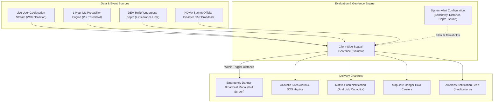

# DOAB Auto-Alert Engine & System Configuration Specification
**Real-Time Life-Safety Broadcasts, Geofencing Triggers & User Customization**

---

## 1. Executive Summary

DOAB's alert system is designed to provide life-critical warning broadcasts to drivers, commuters, and emergency responders before they enter submerged underpasses or flash flood zones.

This specification documents:
1. **Current State**: What events trigger alerts in DOAB right now.
2. **Identified Gaps**: Why `EmergencyDangerBroadcast` was decoupled from `MapPage`, and what System Alert Configurations were missing.
3. **The Target Alert Lifecycle**: Event triggers, delivery channels, and configuration parameters.



---

## 2. How Auto-Alerts Work Right Now (Current State)

### What exists today:
1. **All Alerts Feed (`/notifications`)**:
   - Aggregates historical ground-truth waterlogging events (`WATERLOGGING_DATASET_INCIDENTS`).
   - Surfaces model prediction cells where $P(\text{Waterlogging}) \ge 0.35$.
   - Displays admin-broadcasted simulated alerts (`doab_admin_custom_alerts`) triggered via the Remote Admin Channel (NTFY).
2. **Emergency Danger Broadcast Modal (`EmergencyDangerBroadcast.tsx`)**:
   - High-priority full-screen modal component.
   - Triggers `playAlertAlarm()`, `triggerSosHaptics()`, and `sendEmergencyNotification()`.
   - Displays distance ahead, standing water depth (cm), and ward name.
3. **Map Danger Halos (`MapPage.tsx`)**:
   - Evaluates macro recurring flood clusters by Ward/Corridor.
   - Highlights high-severity clusters with pulsating radial danger halos (`#BE123C` for Critical).

### The Critical Missing Links:
* ⚠️ **Decoupled Danger Broadcast**: `EmergencyDangerBroadcast` is coded and styled with sound alarms and haptics, but was **never mounted inside `MapPage.tsx`** during live navigation!
* ⚠️ **Missing Alerts Configuration UI**: Users currently have vehicle clearance settings (`15cm / 20cm / 25cm`), but **cannot configure alert proximity distances, alarm volumes, or which hazard categories should trigger loud sirens**.

---

## 3. The 4 Core Auto-Alert Events (Event Trigger Matrix)

| Event Type | Trigger Condition | Default Threshold | Delivery Channel | Action Required |
| :--- | :--- | :---: | :--- | :--- |
| **1. Proximity Geofence Warning** | User's GPS trajectory moves within proximity of an active flood polygon or underpass. | User within **500 meters** of flood zone. | `EmergencyDangerBroadcast` + Map marker halo. | Prompts immediate 1-tap reroute. |
| **2. Vehicle Clearance Violation** | Standing water depth in the path ahead exceeds the driver's vehicle ground clearance. | Water depth $>$ **15 / 20 / 25 cm** (set in Profile). | Audio alarm siren + Haptic SOS + Red alert modal. | Warns of engine stall & vehicle float risk. |
| **3. Official NDMA Sachet Broadcast** | Government issues an official Red / Orange emergency flood or cloudburst alert for the user's active district. | Official CAP broadcast severity = `Emergency` or `Warning`. | High-priority push banner + Notification badge + Siren. | Advises staying indoors or seeking high elevation. |
| **4. Cloudburst Acceleration Surge** | Instantaneous rainfall rate increases sharply ($\text{trend}_{1h-3h} > 15\text{ mm/h}$). | Model probability spikes from $<0.30$ to $>0.75$ in $<30\text{ mins}$. | Subtle kinetic rolling headline banner + Map notification. | Early alert before water pools on roads. |

---

## 4. System Alerts Configuration (The Missing Feature)

To provide users control over their sensory and safety experience, DOAB requires a **System Alerts Configuration Panel** with the following stateful controls:

```typescript
export interface SystemAlertsConfig {
  // 1. Proximity & Sensitivity
  proximityDistanceMeters: 250 | 500 | 1000;
  minimumProbabilityThreshold: 0.35 | 0.50 | 0.70;
  
  // 2. Channels & Sensory Feedback
  soundAlarmEnabled: boolean;       // Loud emergency siren
  hapticFeedbackEnabled: boolean;    // Device vibration
  pushNotificationsEnabled: boolean; // Background system push
  
  // 3. Hazard Subscriptions
  subscribeOfficialNdma: boolean;    // National disaster alerts
  subscribeMunicipalReports: boolean;// Ward waterlogging complaints
  subscribeFlashSurge: boolean;      // Cloudburst acceleration warnings
}
```

### Storage & Persistence:
* Stored in `localStorage` under key `doab_system_alerts_config`.
* Synced across tabs via `window.dispatchEvent(new CustomEvent('doab:alerts-config-changed'))`.

---

## 5. Implementation Roadmap

1. **Mount `EmergencyDangerBroadcast` in `MapPage.tsx`**:
   - Compute real-time distance between `userCoords` and nearest `filteredIncidents` / `liveCells`.
   - If distance $\le \text{proximityDistanceMeters}$ and water depth $\ge \text{clearanceLimit}$, automatically set `isEmergencyBroadcastOpen = true`.
2. **Add System Alerts Configuration UI**:
   - Add an "Emergency Alert Triggers" section to `PreferencesModal.tsx` and `ProfilePage.tsx`.
   - Allow toggling Alert Distance (250m / 500m / 1000m), Siren Audio on/off, and Minimum Hazard Sensitivity.
3. **Bridge NDMA Live Stream**:
   - Poll `/alerts/live` in `useTelemetry` / `NotificationPage` and surface genuine official national warnings.
