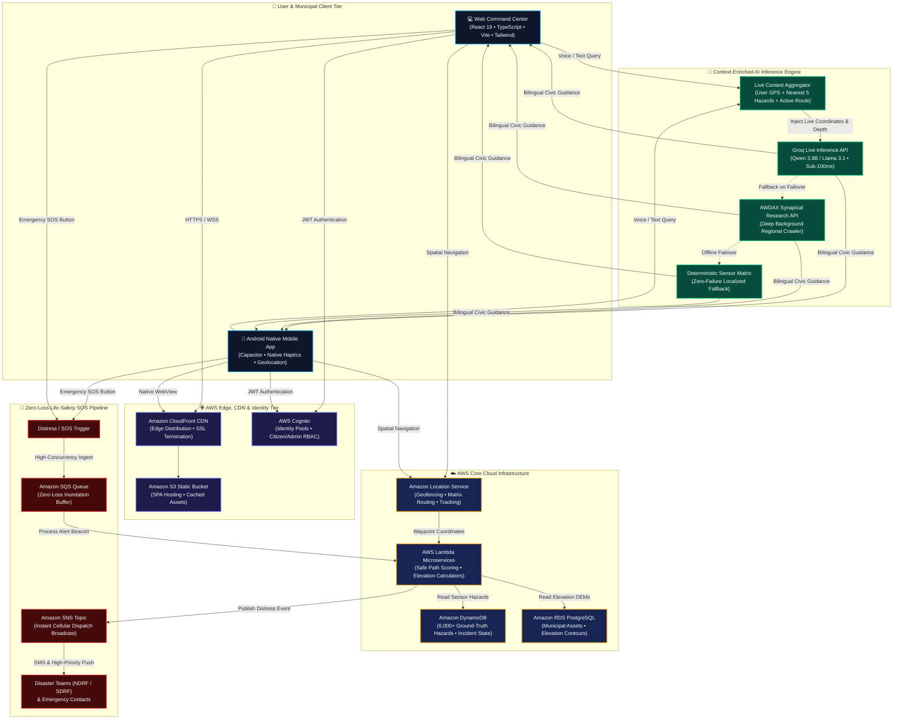
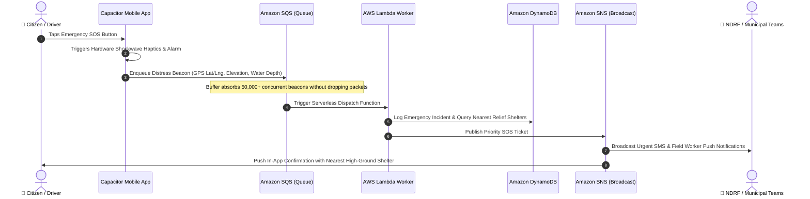
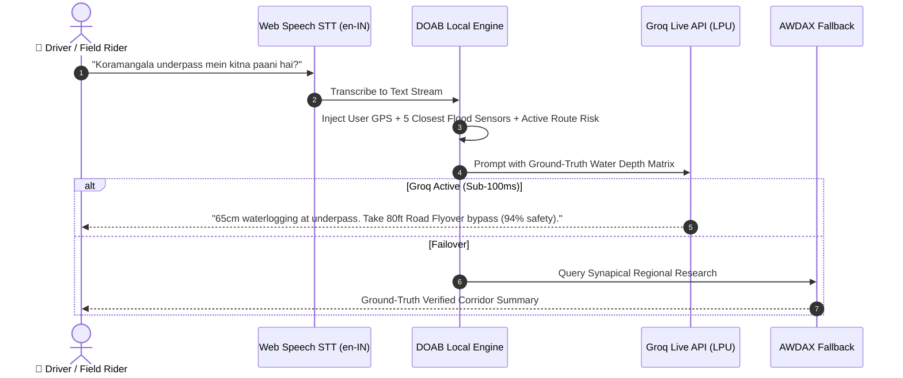

# 🏛️ DOAB & AWS Cloud Architecture Specification
## Comprehensive Architecture & Data Flow Diagrams

This document contains the complete, production-grade Mermaid architectural diagrams for the DOAB platform, illustrating the interplay between client devices, the AWS Serverless Mesh, AI inference pipelines, and municipal emergency broadcast channels.

---

### 1. End-to-End System Architecture (Complete Flowchart)

---

### 2. Emergency SOS Beacon Execution (Sequence Diagram)

---

### 3. Context-Enriched Groq Copilot Flow (Sequence Diagram)

