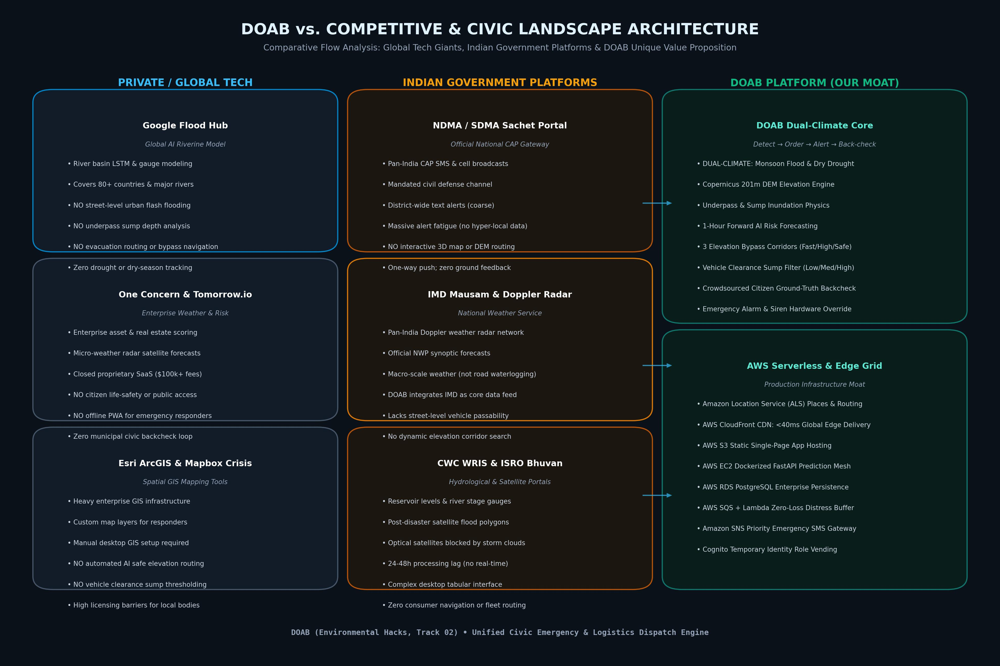
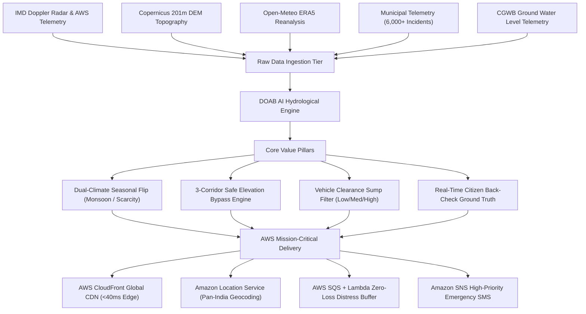

# 📊 DOAB (दोआब) — Competitive & Government Landscape Analysis
**Single Source of Truth: Global Tech Benchmarking, Indian Official Portals & DOAB Architectural Moats**  
*Track 02: Environmental Hacks • Life-Safety Civic Grid*

---

## 🎯 Executive Summary

Modern climate disaster management in India requires handling extreme seasonal duality:
1. **Monsoon Season**: Rapid urban flash floods, sub-level underpass drownings, and transport paralysis.
2. **Dry / Pre-Monsoon Season**: Extreme borewell depletion, water tanker delivery deficits, and fatal thermal heatwaves.

Existing commercial platforms (Google Flood Hub, Tomorrow.io, One Concern) and Indian government portals (NDMA Sachet, IMD Mausam, CWC India-WRIS, ISRO Bhuvan) solve specific pieces of this puzzle, but **leave a critical 200-meter life-safety gap**. They forecast macro-level weather or large river basins, but cannot tell a commuter, ambulance driver, or delivery partner whether the underpass 200 meters ahead is flooded by 80cm of water.

**DOAB (Detect → Order → Alert → Back-check)** closes this loop with digital elevation model (DEM) hydrological simulation, 3 safe elevation corridors, and real-time bidirectional citizen ground-truth verification on AWS Cloud infrastructure.

---

## 🗺️ System Topology & Competitor Landscape Flowchart

---

## 📊 Comprehensive Competitive Feature Matrix

| Capability / Dimension | DOAB Platform | Google Flood Hub | NDMA Sachet Portal | IMD Mausam / Radar | CWC India-WRIS | Tomorrow.io / One Concern |
| :--- | :--- | :--- | :--- | :--- | :--- | :--- |
| **Dual-Climate Engine** | **YES (Flood + Drought)** | NO (River Flood Only) | Partial (SMS Only) | Weather Only | Hydrology Only | Weather Only |
| **Street & Sump Inundation Depth** | **YES (DEM + Sump Physics)** | NO (Basin Polygons) | NO (District-wide) | NO (Rainfall Only) | NO (River Gauges) | NO (Enterprise) |
| **3D Safe Elevation Bypass Routing** | **YES (3 Corridors: Fast/High/Safe)** | NO (Static Map) | NO (Text SMS) | NO (Bulletins) | NO (Tabular) | NO (Enterprise) |
| **Vehicle Clearance Thresholding** | **YES (15cm / 35cm / 65cm)** | NO | NO | NO | NO | NO |
| **Ground-Truth Backcheck Loop** | **YES (Bidirectional Verification)** | NO (One-way) | NO (One-way) | NO | NO | NO |
| **Emergency Siren / Haptic Override** | **YES (Device Hardware Alarm)** | NO | Partial (Cell Broadcast) | NO | NO | NO |
| **Cloud Edge Latency** | **AWS CloudFront (<40ms)** | Google Cloud Edge | NIC Gateway (Slow) | NIC Data Center (Slow) | NIC Portal (Tabular) | Cloud SaaS (Paid) |
| **Offline PWA / Field Responder APK** | **YES (ServiceWorker + Cache)** | NO | Mobile App (Basic) | Mobile App (Basic) | Desktop Only | Web Only |

---

## 🔍 Detailed Competitor Deep-Dive: Where They Excel vs. What DOAB Does Better

### 1. Google Flood Hub (Global Tech Leader)
- **Where Google Excels**:
  - Unrivaled global riverine reach across 80+ countries covering 460 million citizens.
  - Deep hydrologic LSTM neural networks trained on historical gauge data and satellite altimetry.
  - Deep distribution network through Google Search alerts and Android device push.
- **Key Gaps & Shortcomings**:
  - **Macro-Riverine Only**: Models large river catchments (Ganga, Brahmaputra, Mississippi). It completely ignores localized urban flash floods, stormwater drain choke points, and underpass sumps.
  - **Zero Safe Path Routing**: Only shows polygon risk zones. Does not provide turn-by-turn bypass navigation or high-elevation corridors.
  - **No Clearance Awareness**: Cannot tell if an underpass has 20cm vs 120cm of water.
  - **Single-Season Limitation**: Inactive during dry periods; zero drought or water tanker logistics support.
- **The DOAB Advantage**:
  - DOAB computes hyper-local 201m Copernicus DEM elevation baselines, modeling sub-surface sumps and providing 3 elevation bypass corridors for commuters and logistics fleets.

---

### 2. NDMA Sachet Portal (National Disaster Management Authority)
- **Where Sachet Excels**:
  - Official Government of India Common Alerting Protocol (CAP) mandate.
  - Direct integration with cellular telecommunications providers for emergency broadcast SMS.
- **Key Gaps & Shortcomings**:
  - **Coarse District-Wide Alerts**: Alerts read "Heavy rain warning for Bengaluru Urban district", triggering severe alert fatigue. Citizens ignore them because they lack street-level context.
  - **One-Way Push**: Citizens cannot confirm ground reality or submit live water depths.
  - **No Interactive Map or Elevation Analysis**: Operates primarily as an SMS and notification push service.
- **The DOAB Advantage**:
  - DOAB pinpoints exact street coordinates, displays water depth in centimeters, triggers audible siren hardware overrides, and provides a bidirectional feedback loop where citizen verifications adjust model confidence.

---

### 3. India Meteorological Department (IMD) Mausam & Doppler Radar
- **Where IMD Excels**:
  - World-class scientific meteorological agency with 35+ Doppler Weather Radars (DWR) and thousands of Automatic Weather Stations (AWS).
  - High-accuracy Numerical Weather Prediction (NWP) synoptic forecasts.
- **Key Gaps & Shortcomings**:
  - **Atmospheric, Not Hydrological**: IMD measures atmospheric precipitation falling from clouds, not accumulation on roadways. A 50mm cloudburst creates zero hazard on an elevated flyover, but catastrophic drowning risk in a depressed underpass.
  - **No Civic Routing**: Does not calculate route passability for vehicles or pedestrians.
- **The DOAB Advantage**:
  - **DOAB ingests IMD Doppler Radar and AWS telemetry as an upstream data source**, fusing atmospheric rain rates with Copernicus DEM topography to model ground inundation and route passability.

---

### 4. CWC India-WRIS & ISRO Bhuvan
- **Where CWC & ISRO Excel**:
  - Central Water Commission monitors reservoir storage, dam discharge, and river stage gauges.
  - ISRO Bhuvan provides satellite-derived flood inundation maps.
- **Key Gaps & Shortcomings**:
  - **Post-Event Processing Lag**: Optical satellites cannot pierce heavy monsoon clouds during the event. Bhuvan maps take 24–48 hours to compile, making them historical assessments rather than real-time navigation aids.
  - **Heavy Engineering Interfaces**: Designed for water resource engineers and dam managers, not emergency responders or citizens in transit.
- **The DOAB Advantage**:
  - DOAB operates 60 minutes *forward* in time, calculating inundation probabilities and safe corridors in real-time on AWS edge servers without waiting for post-event satellite passes.

---

## 🏛️ DOAB Architectural Moats & Technical Differentiators

---

## 📋 Document Information
- **Generated**: October 2026
- **Project**: DOAB (Detect, Order, Alert, Back-check)
- **Files Created**:
  - Flowchart: [`docs/COMPETITOR_LANDSCAPE_FLOWCHART.jpg`](./COMPETITOR_LANDSCAPE_FLOWCHART.jpg)
  - Word Document: [`docs/COMPETITIVE_ANALYSIS.docx`](./COMPETITIVE_ANALYSIS.docx)
  - Markdown Whitepaper: [`docs/COMPETITIVE_ANALYSIS.md`](./COMPETITIVE_ANALYSIS.md)
