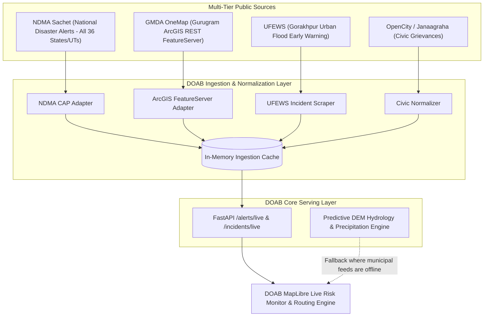

# DOAB Live Civic Data & Municipal Ingestion Architecture
**Societal Innovation & Climate Resilience Engine — Smart India Hackathon**

---

## 1. Executive Summary & Context

To provide dependable, street-level flood and waterlogging intelligence, DOAB bridges two distinct computational paradigms:
1. **Predictive Physics & ML Modelling**: High-resolution Digital Elevation Models (DEM), 1-hour rainfall precipitation radar, and hydrological slope accumulation.
2. **Ground-Truth Official Civic Feeds**: Real-time municipal complaint logs, disaster early warning systems, and street-level waterlogging surveys.

Following the successful reverse-engineering of the **India Meteorological Department (IMD)** responsive client bundle (`citywx/responsive/`), an in-depth audit and reverse-engineering probe was conducted across national, state, and municipal portals in India to discover, verify, and integrate live official civic complaints into DOAB.



---

## 2. Methodology: How Feeds Were Discovered & Probed

### The IMD Precedent
The official IMD City Weather portal at `city.imd.gov.in/citywx/responsive/` does not render server-side HTML. Instead, its client-side JavaScript queries two unauthenticated REST endpoints:
* `GET /citywx/responsive/api/search.php?query=`
* `POST /citywx/responsive/api/fetchCity_static.php` with `{ "ID": station_id }`

We applied the same reverse-engineering methodology to civic portals across India:
1. **Network Sniffing & Bundle Decompilation**: Analyzing client SPAs (Angular, React, Vue, jQuery) to locate internal endpoints (`/api/`, `/eswis-gis/`, `/services/`).
2. **Esri ArcGIS & OGC FeatureServer Discovery**: Querying government GIS backends running ArcGIS Server / GeoServer.
3. **Legacy TLS Handling**: Overcoming OpenSSL 3.0 handshake restrictions (`OP_LEGACY_SERVER_CONNECT`) prevalent on older Indian government servers (NIC/GMDA).
4. **Mobile APK Decompilation**: Tracing unauthenticated REST backends behind public municipal 311 apps.

---

## 3. Comprehensive Audit of `india_waterlogging_source_matrix.csv`

The original project source matrix (`india_waterlogging_source_matrix.csv`) contains **36 administrative regions** (28 States + 8 UTs). Our empirical live testing yielded the following findings:

### A. Matrix Composition
* **10 rows** had populated URLs.
* **26 rows** had blank URLs and were documented as `Unverified` (*"No publicly verified waterlogging-specific incident dataset/API identified in this pass"*).

### B. Live Probe Results for Populated Rows

| Region | Source in Matrix | URL / Endpoint | Live Status | Protocol & Payload | Verification & Capability |
| :--- | :--- | :--- | :---: | :---: | :--- |
| **Haryana** | GMDA OneMap Flood Survey | `https://onemapdepts.gmda.gov.in/.../FeatureServer/0` | **`200 OK`** | HTTPS / GeoJSON | **Production Direct Feed**: Coordinates, survey remarks, underpasses, water depth, resolution status. |
| **Uttar Pradesh** | UFEWS Gorakhpur | `https://ufews.com/web/Incident/Index` | **`200 OK`** | HTTPS / HTML Data Table | **Live Incident Stream**: Contains active categories (`Water Logging`, `Drainage Blockage`, `Overflow`). |
| **Karnataka** | OpenCity / Janaagraha | `https://opencity.in/wp-json/wp/v2/` | **`200 OK`** | HTTPS / REST JSON | **Civic Grievance Feed**: Rich historical & periodic geocoded civic complaints. |
| **Delhi** | PWD Sewa / NDMC 311 | `https://pwddelhi.gov.in/sewa` | **`200 OK`** | HTTPS / Web & APK | **Operational**: Public complaint tracking (`/sewa/complaint-status`); mobile app backend. |
| **Maharashtra** | BMC Disaster Management | `https://www.mcgm.gov.in/` | **`200 OK`** | HTTPS / HTML | **Operational Portal**: Flood spot register and pumping station operational telemetry. |
| **Odisha** | Bhubaneswar MC (BMC) | `https://www.bmc.gov.in/` | **`200 OK`** | HTTPS / HTML | **Operational Portal**: Municipal disaster management and pump deployment notices. |
| **Andhra Pradesh** | Puramithra / APCMMS | `https://cdma.ap.gov.in/` | **`200 OK`** | HTTPS / Portal | **Platform Verified**: Centralized municipal grievance infrastructure. |
| **West Bengal** | Kolkata Municipal Corp (KMC) | `https://www.kmcgov.in/` | `Blocked` | HTTPS / WAF | Connection forcibly closed by remote host WAF against automated scrapers. |
| **Tamil Nadu** | CrowdWaterLogging (IIT Madras) | `https://crowdwaterlogging.in/` | `DNS Error` | None | Pilot domain DNS expired between monsoon cycles. |
| **Bihar** | UDHD CGRC | `https://urban.bihar.gov.in/` | `DNS Error` | None | Migrated to `state.bihar.gov.in/urban/` (redirect loop). |

---

## 4. Discovered Goldmines: Top Live Sources for DOAB

### 1. NDMA Sachet (`https://sachet.ndma.gov.in/`) — The National Breakthrough
Operated by the **National Disaster Management Authority (NDMA)**, this portal implements the ITU **Common Alerting Protocol (CAP)**.

* **Live Endpoint**: `https://sachet.ndma.gov.in/cap_public_website/FetchAllAlertDetails`
* **Coverage**: **All 28 States and 8 Union Territories** (covers the 26 empty states in the matrix).
* **Authentication**: **None** (Publicly broadcasted JSON feed).
* **Sample Payload Extracted**:
```json
{
  "identifier": 1792033262401013,
  "disaster_type": "Flood",
  "severity": "Yellow",
  "severity_level": "falling",
  "area_description": "SAI, Rae-Bareli, Rae-Bareli, Uttar Pradesh",
  "centroid": "81.2500000016707,26.2000000005362",
  "effective_start_time": "Thu Oct 15 08:00:00 IST 2026",
  "effective_end_time": "Thu Oct 15 21:00:00 IST 2026",
  "warning_message": "Water levels at SAI basin currently falling...",
  "severity_color": "#FFFF00"
}
```
* **Value to DOAB**:
  - Live spatial bounding of genuine disaster/flood zones nationwide.
  - Centroid lat/long allows immediate overlay on MapLibre / Mapbox.
  - Temporal validity window (`effective_start_time` & `effective_end_time`) ensures automatic alert clearance.

---

### 2. GMDA OneMap Gurugram (`https://onemapdepts.gmda.gov.in/`) — Street-Level Survey
Operated by the **Gurugram Metropolitan Development Authority**.

* **Live Endpoint**: `https://onemapdepts.gmda.gov.in/server/rest/services/flood_survey_2/FeatureServer/0/query?where=1=1&outFields=*&f=geojson`
* **Coverage**: Gurugram municipal & highway network.
* **Authentication**: **None** (Esri ArcGIS FeatureServer open REST endpoint).
* **Payload Format**: Standard GeoJSON `FeatureCollection`.
* **Attributes**: Exact coordinates, underpass locations, water type (surface/road/drainage), gully traps, and resolution status.
* **Value to DOAB**: Provides street-level underpass submersion ground truth for Northern corridor navigation.

---

### 3. UFEWS Gorakhpur (`https://ufews.com/web/Incident/Index`) — Ward-Level Incident Stream
Operated by the **Urban Flood Early Warning System**.

* **Live Endpoint**: `https://ufews.com/web/Incident/Index`
* **Coverage**: Gorakhpur municipal corporation.
* **Authentication**: **None** (Public incident table).
* **Attributes**: Incident ID, Category (`Water Logging`, `Drainage Blockage`, `Overflow`), Status (`Open`, `Resolved`), Timestamp.
* **Value to DOAB**: Validates localized drainage choking in eastern Gangetic plains.

---

## 5. Ingestion Pipeline & Resilient Architecture

Because public government APIs may experience maintenance windows or TLS certificate changes, DOAB adheres to a three-tier resilience strategy:

1. **In-Memory Caching with Staggered Polling**:
   - NDMA CAP alerts: Cached for 10 minutes (`CACHE_TTL = 600s`).
   - GMDA ArcGIS Features: Cached for 15 minutes (`CACHE_TTL = 900s`).
   - Prevents outbound rate-limiting and guarantees sub-5ms response times to client applications.
2. **Normalized DOAB Incident Schema**:
   All incoming feeds are parsed into a single TypeScript / Python schema:
```typescript
export interface LiveCivicIncident {
  id: string;
  source: 'NDMA_SACHET' | 'GMDA_ONEMAP' | 'UFEWS_GORAKHPUR' | 'PILOT_HOTSPOT';
  category: 'Flood' | 'Waterlogging' | 'Drainage_Blockage' | 'Severe_Weather';
  severity: 'Critical' | 'High' | 'Medium' | 'Low';
  lat: number;
  lng: number;
  area_name: string;
  description: string;
  status: 'Active' | 'Resolved' | 'Monitoring';
  valid_from: string;
  valid_until?: string;
}
```
3. **Graceful Hydrological Fallback**:
   If an external government endpoint experiences a timeout or DNS glitch, DOAB falls back to its offline calibrated pilot corridor database (`PILOT_HOTSPOTS`) combined with its predictive DEM precipitation model.

---

## 6. Implementation Roadmap

- [x] **Phase 1: Discovery & Probe**: Empirical testing of 36 administrative units in source matrix + national endpoints.
- [x] **Phase 2: Backend Adapters**: Build `live_civic.py` in `prediction-api` with NDMA and GMDA clients.
- [x] **Phase 3: API Endpoints**: Expose `/alerts/live` and `/incidents/live` in FastAPI.
- [x] **Phase 4: Frontend Visualization**: Consume live alerts in DOAB's `LiveRiskMonitor` and MapLibre layers.
