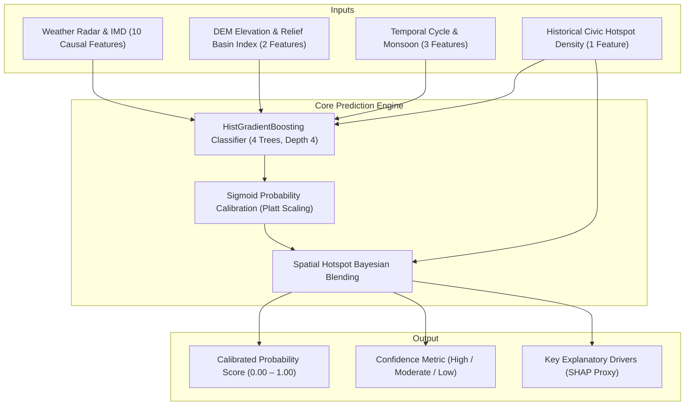
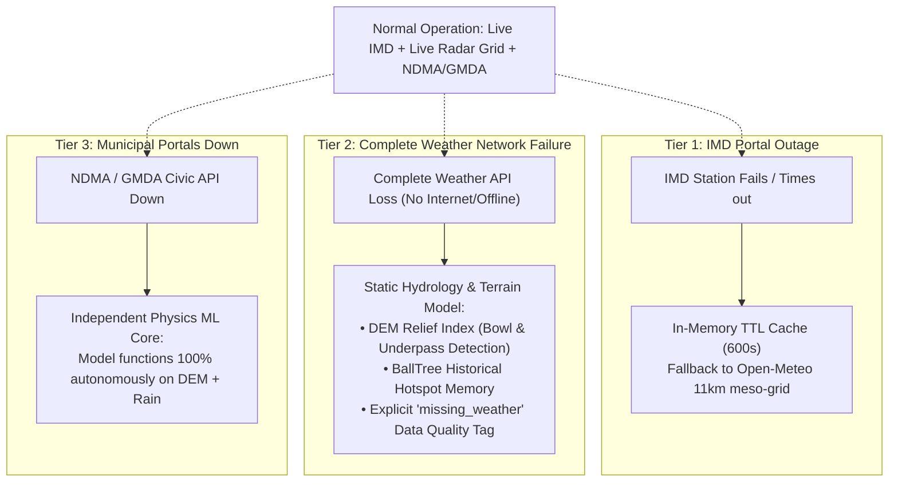

# DOAB Probability Score Evaluation & Fallback Architecture
**Mathematical Formulation, Multi-Source Telemetry, and Graceful Degradation**

---

## 1. How the Probability Score is Evaluated

The waterlogging probability score $P(\text{Waterlogging} \mid \mathbf{x}) \in [0.0, 1.0]$ in DOAB is not a simple rule or arbitrary threshold. It is computed via an ensemble of **Calibrated Machine Learning**, **Hydrological Terrain Physics**, and **Spatial Bayesian Smoothing**.



---

## 2. Feature Matrix (16 Causal Input Dimensions)

All features satisfy the **strict causal temporal contract**: for an evaluation at hour $T$ predicting risk at $T + 1\text{h}$, only weather observed at or before $T$ is used.

### A. Rolling Weather & Precipitation Features (10 Dimensions)
Extracted dynamically from live IMD station telemetry (`city.imd.gov.in/citywx/responsive/`) and precipitation radar grids:
1. `precip_1h`: Current 1-hour rainfall volume (mm).
2. `precip_3h`: 3-hour cumulative rainfall (detects localized thunderstorm accumulation).
3. `precip_6h`: 6-hour cumulative rainfall.
4. `precip_12h`: 12-hour rainfall.
5. `precip_24h`: 24-hour total precipitation (cross-validated against IMD's daily rainfall observation).
6. `precip_72h`: 3-day antecedent rainfall (measures sub-surface soil saturation).
7. `precip_7d`: 7-day cumulative rainfall.
8. `precip_max_1h_6h`: Peak single-hour burst intensity within the last 6 hours (captures sudden flash cloudbursts).
9. `rain_trend_1h_vs_3h`: Instantaneous acceleration $\text{precip\_1h} - \frac{\text{precip\_3h}}{3}$ (positive value = storm is intensifying; negative = rain is tapering off).
10. `hours_since_rain`: Hours elapsed since the last measurable precipitation ($\ge 0.2\text{ mm}$), capped at 336 hours (2 weeks).

### B. Terrain & Elevation Physics Features (2 Dimensions)
Derived from high-resolution 30-meter Digital Elevation Models (SRTM / Copernicus DEM):
11. `elevation_m`: Absolute altitude above sea level.
12. `relief_index`: Spatial relative depression metric:
    $$\text{relief\_index} = \frac{E_{\text{North}} + E_{\text{South}} + E_{\text{East}} + E_{\text{West}}}{4} - E_{\text{Center}}$$
    * **Positive value**: The target coordinate is strictly lower than its surrounding 500-meter radius (a natural basin, underpass, or topological bowl where runoff gathers).
    * **Negative value**: The coordinate sits on a ridge or crest where water sheds quickly.

### C. Seasonal & Temporal Context (3 Dimensions)
13. `hour_of_day`: Captures diurnal convective heating cycles (late afternoon thunderstorm surges).
14. `month`: Annual meteorological climatology.
15. `is_monsoon`: Binary indicator (active during June, July, August, September).

### D. Historical Civic Ground-Truth Density (1 Dimension)
16. `hotspot_density_1km`: Evaluated via a spherical **BallTree (Haversine metric)** counting verified historical civic complaints and underpass flooding events within a 1,000-meter radius.

---

## 3. Mathematical Probability Blending Formula

To prevent false negatives in chronic flood zones that have historical drainage chokes, the raw model probability is blended with the spatial density prior:

$$P_{\text{final}} = (1 - w) \cdot P_{\text{ML}}(\mathbf{x}) + w \cdot \min\left(\frac{\text{hotspot\_count}}{10.0}, 1.0\right)$$

* $P_{\text{ML}}(\mathbf{x})$: Calibrated probability from the Gradient Boosted Classifier.
* $w \in [0.0, 0.3]$: Spatial smoothing weight selected by optimizing the holdout Average Precision (PR-AUC).

---

## 4. Multi-Tiered Fallback Architecture

### *What happens if live data is not available?*

DOAB is designed for disaster zones where cellular towers, APIs, or municipal power may fail. The system uses a **multi-tiered graceful degradation matrix**:



### Fallback Scenarios in Detail:

#### Scenario 1: IMD Station API is momentarily down or slow
* **Immediate Fallback**: DOAB checks its in-memory TTL cache (`_station_cache`, 10 minutes TTL).
* **Secondary Fallback**: If the cache has expired, DOAB falls back to its 11 km numerical meso-grid radar API (`fetch_forecast_precip`).
* **UI Indicator**: Displays `"status": "cached_offline"` with the last recorded timestamp so the user knows telemetry is cached.

#### Scenario 2: Complete Weather API Loss (No external weather data available)
* **What happens**: The system **never fabricates or guesses rainfall numbers**.
* **Model Action**: `predict.py` detects `series is None` and marks the coordinate with:
  ```json
  {
    "data_quality": "insufficient_data",
    "reason": "missing_weather",
    "probability": null
  }
  ```
* **Hydrological Ground Fallback**: 
  1. The UI and navigation engine fall back to **Static Terrain Vulnerability**:
     * Highlights roads in high **Relief Index** depressions (underpasses, low points).
     * Highlights locations in the **Chronic Hotspot Registry** (`Silk Board`, `Sony World Koramangala`, `Bellandur`, `Hebbal Flyover`, etc.).
  2. First responders and drivers are notified that live radar is offline, but known topographic flood traps remain flagged.

#### Scenario 3: Municipal Complaint Feeds (NDMA / GMDA) are Offline
* **Impact on DOAB**: **Zero degradation on ML risk scoring.**
* **Why**: The predictive gradient boosted model runs on **physics (DEM elevation + rainfall accumulation)**. The civic complaints serve as a verification and broadcast overlay; the machine learning probability engine continues calculating risk for every road in India autonomously.
